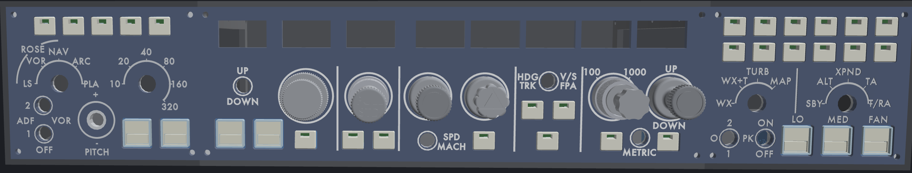
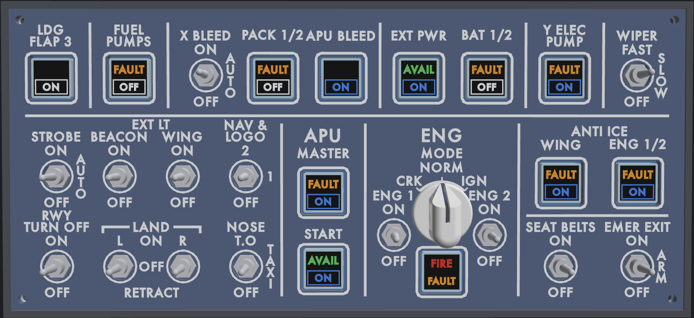
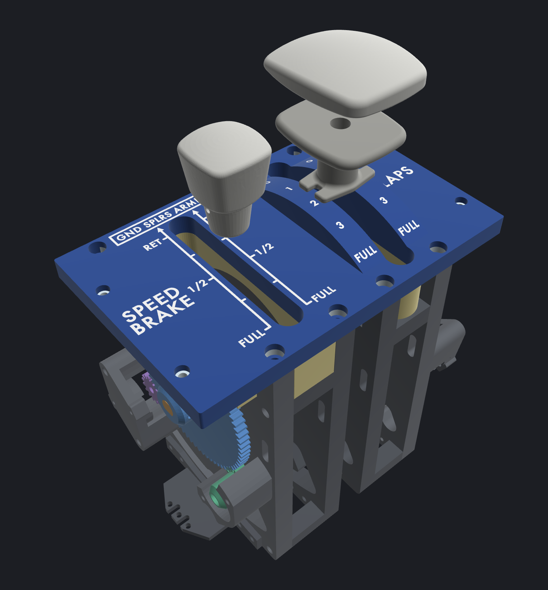

# FCU Mk2 and overhead panel

ESPHome firmware and OpenSCAD panels for two ToLiss A320 cockpit panels, each driven by an
ESP32-S3 talking to X-Plane 12 over UDP (`xplane_client` with `udp: true`).

The korries use Mark Ayton's (MANTOGA) designs from Printables, scaled to 80%:

- [Airbus A320 Korry style switch for 3mm panels](https://www.printables.com/model/915481-airbus-a320-korry-style-switch-for-3mm-panels)
- [Airbus A320 EFIS Korry style Switch](https://www.printables.com/model/635792-airbus-a320-efis-korry-style-switch)

## FCU Mk2

EFIS, FCU and ECAM control panel in one panel, plus weather radar (mode, system) and
transponder selectors, park brake, pitch trim, and korries for GPWS, TERR ON ND, autobrake and
brake fan.

| File | What |
|---|---|
| [fcu_mk2.yaml](fcu_mk2.yaml) | Firmware: eight SSD1306 OLEDs behind a TCA9548A for the FCU windows, button matrix and rotary encoders on MCP23017s, rotary selectors read through ADS1115s, lamps and backlights on three daisy-chained TLC5947s |
| [pkg/](pkg/) | Button templates used by the firmware: lit buttons, korries, blink and clear buttons |
| [front_panel.scad](front_panel.scad) | Front panel |
| [fcu_enclosure.scad](fcu_enclosure.scad) | Enclosure |

## Overhead panel

A compact A320 overhead: exterior lights, fuel, packs, APU, electrics, anti-ice, ENG master and
mode.

| File | What |
|---|---|
| [ohp.yaml](ohp.yaml) | Firmware: switches and korries on three MCP23017s, korry lamps on one TLC5947 |
| [oh_panel.scad](oh_panel.scad) | Front panel |
| [oh_enclosure.scad](oh_enclosure.scad) | Enclosure |

## Flaps and speedbrake

Flaps and speedbrake levers built from Mark Ayton's (MANTOGA) A320 models, each reading its lever
angle with a Hall-effect sensor, under one combined printed panel:

- [Airbus A320 Speedbrake Mechanism](https://makerworld.com/en/models/1605940-airbus-a320-speedbrake-mechanism) (MakerWorld)
- [Airbus A320 Flaps Mechanism](https://www.printables.com/model/809640-airbus-a320-flaps-mechanism) (Printables)
- [Airbus A320 Flaps Handle](https://www.printables.com/model/786201-airbus-a320-flaps-handle) (Printables)

| File | What |
|---|---|
| [flaps_speedbrake.yaml](flaps_speedbrake.yaml) | Firmware: both Hall sensors on the ESP32's ADC, writing `AirbusFBW/FlapLeverRatio` and `sim/cockpit2/controls/speedbrake_ratio` |
| [flaps_speedbrake_panel.scad](flaps_speedbrake_panel.scad) | Combined speedbrake and flaps panel, about 160 x 100 mm, in place of MANTOGA's two acrylic panels; printed in three 3 mm layers with backlit legends |
